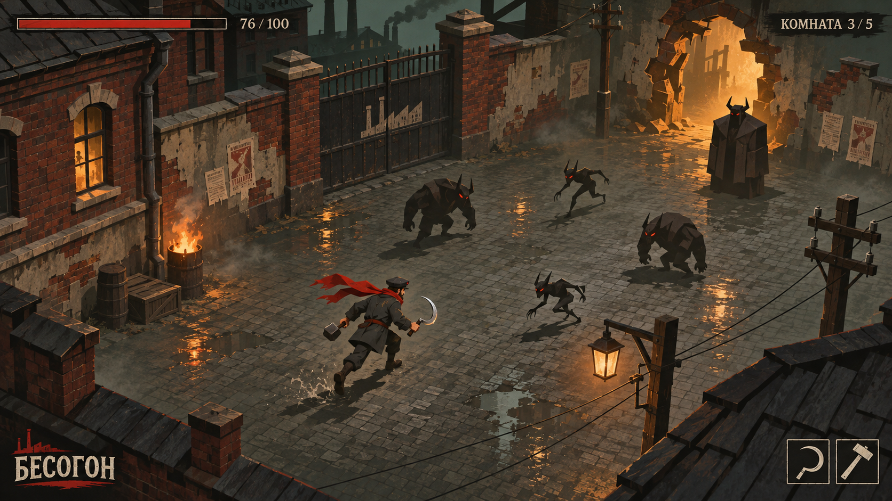
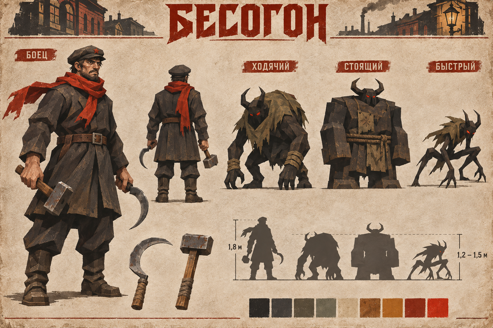
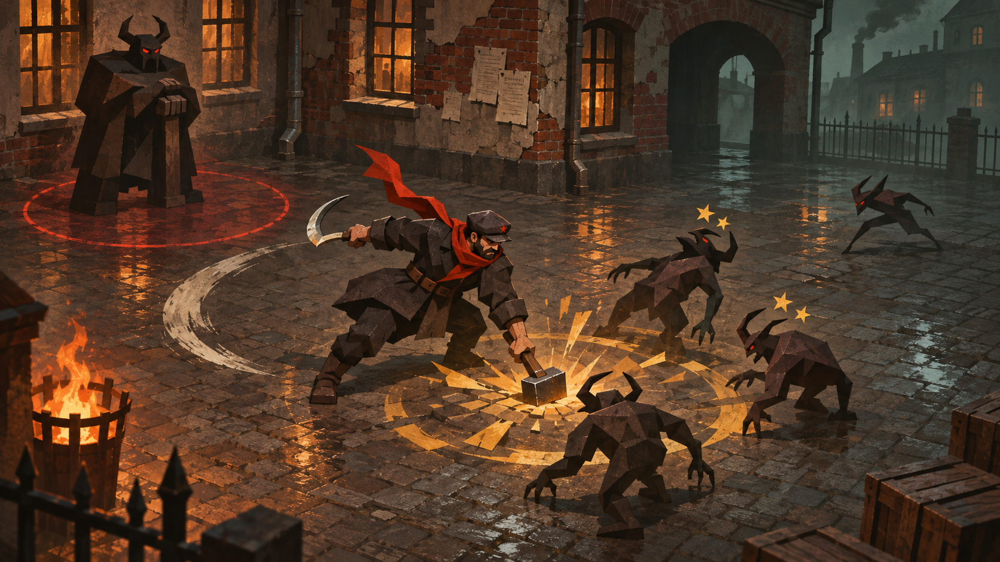

# БЕСОГОН — утверждённое визуальное направление

**Статус:** утверждено пользователем.  
**Дата утверждения:** 9 ноября 2026 года.  
**Версия:** 1.0.  
**Назначение:** основной визуальный ориентир для дальнейшей разработки игры в Godot.

**Основание:** пользователь одобрил три созданных концепт-арта — арену, лист персонажей и бой — и поручил закрепить их как утверждённый визуал.

---

## 1. Главное решение

**Мрачная изометрическая игра в стилизованной 3D-графике. Улица 1918 года, угловатые формы, фактура старого плаката, угольные бесы и красный платок героя.**

Визуал должен одновременно передавать тяжёлую, тревожную атмосферу и сохранять читаемость ручного боя. Игрок быстро находит героя, различает типы врагов и понимает, где пройдёт удар.

Ключевые признаки:

- **Угловатая, гранёная геометрия.** Выразительные крупные формы, заметные плоскости, простые силуэты.
- **Рисованные, потёртые поверхности.** Шероховатый кирпич, облезлая штукатурка, грубая ткань, старое железо и бумага.
- **Сдержанная палитра.** Угольный, серо-оливковый, грязный пергамент и ржавая охра.
- **Красный акцент на герое.** Платок — основной ориентир в бою.
- **Тёплый огонь и холодная тень.** Свет из окон, фонарей и портала отражается в мокрой брусчатке.
- **Компактные эффекты оружия.** Светлая дуга серпа и охристая вспышка молота.

## 2. Утверждённые концепт-арты

Изображения ниже — основные референсы. Текст фиксирует их общие признаки. Случайные детали генерации, точные пропорции отдельных предметов и позы не считаются готовыми техническими чертежами.

### 2.1. Арена — общий игровой вид

**Файл:** [01-arena.png](visual/01-arena.png).

Что закреплено:

- Приподнятая камера сверху под углом, позволяющая видеть площадку боя.
- Замкнутая городская улица или двор с кирпичными стенами и воротами.
- Мокрая брусчатка, неглубокие лужи и отражения огня.
- Облезлая штукатурка, бумажные объявления, деревянные ящики, бочки и столбы.
- Тёмный фон и свободное пространство вокруг участников боя.
- Портал как светящийся пролом или дверной проём на краю арены.
- Сдержанный интерфейс по краям экрана.

**Этот арт — главный ориентир для общего вида игровой сцены.**

### 2.2. Боец и три типа бесов

**Файл:** [02-characters.png](visual/02-characters.png).

Что закреплено:

- Боец в тёмной рабочей одежде, кепке и тяжёлых сапогах.
- Красный платок с длинным свободным концом.
- Отдельные серп и молот с простыми, узнаваемыми формами.
- Три различимых силуэта бесов: сутулый ходячий, массивный стоящий и маленький угловатый быстрый.
- Угольные тела, рога, небольшие светящиеся красные глаза.
- Гранёные объёмы и потёртая фактура, подходящие для стилизованных 3D-моделей.

**Светлый бумажный фон относится к оформлению листа персонажей. Игровое окружение остаётся тёмным.** Подписи роста и масштабные силуэты на листе — ориентиры; точные размеры моделей определяются при сборке сцены.

### 2.3. Бой — комбо «серп → молот»

**Файл:** [03-combat.png](visual/03-combat.png).

Что закреплено:

- Серп оставляет короткую светлую дугу, показывающую направление удара.
- Молот даёт компактную золотисто-охристую вспышку и ударное кольцо у земли.
- Оглушение обозначается небольшими искрами или звёздами над врагами.
- Подготавливаемая атака стоящего беса отмечается красным контуром на земле.
- Эффекты сохраняют видимость героя, оружия и ближайших врагов.

**Приближённая камера на этом арте нужна для показа действия. Основной игровой ракурс берётся из концепта арены.**

## 3. Персонаж — Тихон / боец

| Элемент | Утверждённое направление |
| --- | --- |
| Силуэт | Крепкий, приземистый взрослый рабочий; хорошо виден сверху под углом |
| Одежда | Тёмное рабочее пальто или куртка до середины бедра, брюки, грубый ремень, тяжёлые сапоги |
| Голова | Кепка с маленькой красной звездой, суровое уставшее лицо |
| Главный акцент | Красный платок с длинным концом, заметный в движении |
| Оружие | Короткий стальной серп и тяжёлый молот с простой прямоугольной головкой |
| Материалы | Грубая ткань, потёртая кожа, старое железо |
| Подача | Земной, тяжёлый, физически ощутимый персонаж |

На рабочем игровом масштабе важнее всего узнаваемые кепка, платок, общий силуэт и два оружия. Мелкие детали лица не должны быть необходимы для чтения персонажа.

## 4. Бесы — визуальные различия

| Тип | Силуэт | Что должно читаться в игре |
| --- | --- | --- |
| **Ходячий** | Сутулый, округлый, тяжёлый верх, длинные руки | Приближающийся к игроку противник |
| **Стоящий** | Крупный, широкий, блочный, с квадратным торсом | Неподвижная угроза с атакой по площади |
| **Быстрый** | Маленький, острый, треугольный, низкая посадка | Резкое движение и короткие рывки |

Общие признаки — тёмные угольные тела, рога, красные глаза, грубые поверхности и местами обрывки ткани. Тип врага должен различаться по форме даже без цвета и свечения глаз.

Финальные модели развивают утверждённые силуэты. Простые круги, квадраты и треугольники из HTML служат игровыми заглушками.

## 5. Окружение — улица 1918 года

**Основа:** одна городская среда, которую можно перестраивать из повторно используемых элементов.

Основные элементы:

- Кирпичные дома, стены с облезлой штукатуркой, каменные основания.
- Железные ворота, ограды, арки и проёмы.
- Брусчатка, трещины, небольшие лужи, влажные поверхности.
- Деревянные ящики, бочки, столбы и фонари.
- Потёртые объявления и плакаты как исторические детали.
- Тёплые окна, небольшие источники огня, дымка в глубине сцены.

Историческое время передаётся архитектурой, материалами и отдельными бумажными деталями. Конкретные тексты и символы на плакатах требуют отдельной подготовки; случайные надписи на концептах не являются утверждённым игровым контентом.

**Композиция арены:** свободная площадка для движения в центре, основные декорации по краям. Ближние стены, крыши и столбы не должны закрывать героя и врагов.

## 6. Палитра и свет

| Назначение | Цветовое направление |
| --- | --- |
| Тела бесов, глубокая тень | Угольный, почти чёрный |
| Камень, ткань, общий фон | Приглушённый серо-оливковый |
| Бумага и светлые поверхности | Грязный пергамент |
| Кирпич, ржавчина, огонь | Ржавая охра и тёмный терракотовый |
| Платок, маленькая звезда | Насыщенный красный |
| След серпа | Костяной белый, холодный светло-серый |
| Удар молота, оглушение, портал | Золотистая охра |
| Глаза бесов, предупреждение об атаке | Красный или красно-оранжевый |

Красный платок должен оставаться заметным на фоне окружения. Красные глаза и предупреждения врагов используются локально.

Свет строится на сочетании тёплых источников и холодных дымных теней. Лужи поддерживают композицию отражениями. Туман не скрывает область боя. Тёмные персонажи сохраняют различимый контур на тёмном полу.

Точные значения цветов, яркости и экспозиции подбираются в Godot по утверждённым изображениям.

## 7. Эффекты и интерфейс

### Бой

| Событие | Визуальное обозначение |
| --- | --- |
| Серп | Короткая светлая дуга перед персонажем |
| Молот | Компактная охристая вспышка, ударное кольцо и несколько резких осколочных форм |
| Оглушение | Небольшие охристые искры или звёзды над головой |
| Атака стоящего беса | Красный контур опасной области на полу до удара |
| Портал | Тёплое охристое свечение внутри пролома или дверного проёма |

Эффекты поддерживают направление и силу действия. Их размер и яркость не должны мешать оценивать дистанцию до противника.

### Интерфейс

- Тонкая красная полоса здоровья — слева сверху.
- Счётчик комнат — справа сверху.
- Лаконичные значки серпа и молота — справа снизу.
- Потёртые рамки и спокойная типографика сочетаются с фактурой окружения.
- Основная часть экрана остаётся свободной для боя.

Числа здоровья, номер комнаты, размеры значков и расположение логотипа на концепте — примеры композиции. Они не меняют баланс и функциональные требования прототипа.

## 8. Ориентиры для реализации в Godot

**Движок дальнейшей реализации — Godot, после утверждения HTML-прототипа.** Упоминание Three.js в раннем справочном документе не определяет стек будущей игры.

Рекомендации для реализации утверждённого визуала:

- Стилизованные 3D-модели с выразительными плоскостями и рисованными текстурами.
- Фиксированная камера сверху под углом. Ортографическую проекцию или перспективу с большим фокусным расстоянием выбрать по сравнению с артом арены.
- Модульные стены, ворота, проёмы и элементы улицы для перестройки одной среды.
- Простые, отчётливые движения и позы персонажей; платок подчёркивает движение героя.
- Короткие эффекты ударов у земли и читаемые предупреждения об атаках.
- Проверка силуэтов, контраста и эффектов на фактическом игровом масштабе.

Это рекомендации по воспроизведению визуального направления. Они не фиксируют версию Godot, рендерер, бюджет полигонов, разрешение текстур или устройство анимационной системы.

## 9. Проверка соответствия визуалу

- [ ] Сцена узнаётся как мрачная городская улица начала XX века.
- [ ] Ракурс и масштаб боя соответствуют общему концепту арены.
- [ ] Формы угловатые, поверхности потёртые, палитра сдержанная.
- [ ] Героя легко найти по платку и силуэту.
- [ ] Три типа бесов различаются по форме на игровом расстоянии.
- [ ] Стены и декорации не закрывают участников боя.
- [ ] Серп читается как светлая дуга, молот — как охристый тяжёлый удар.
- [ ] Оглушение и опасная область видны без поясняющего текста.
- [ ] Эффекты, дым и туман сохраняют читаемость происходящего.
- [ ] Интерфейс поддерживает общую стилистику и оставляет бой открытым.

## 10. Границы утверждения

**Утверждено визуальное направление трёх приложенных концептов.**

Этот документ не утверждает готовность HTML-прототипа и не запускает перенос в Godot. Он также не меняет параметры комбо, состав игровых систем, сюжет или план разработки.

Внешний вид босса, ада, дьявола, катсцен и дополнительных локаций этими тремя концептами не определён. Для их разработки использовать закреплённый художественный язык как основу.
