# Задания на отдельные модели

Размеры ниже — рабочие размеры для интеграции. Для персонажей рост указан без кепки или рогов. Изображения дополняют письменные параметры.

## C01 — Тихон — боец

**Приоритет:** P0. **Статус:** развитие утверждённого визуала.  
**Размер:** рост 1,80 м без кепки.  
**Pivot:** между стопами на уровне пола.  
**Имя файла:** `C01_tikhon.glb`.

Кепка входит в C01. Платок показан для посадки; аксессуар W03 можно хранить отдельным мешем. Пустые руки. Серп слева, молот справа крепятся позже. Сохранить разрез нижней части пальто для движения ног.

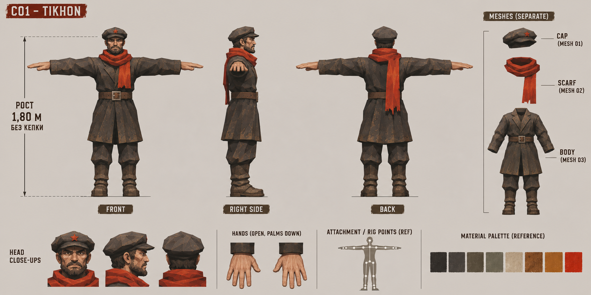

## C02 — Бес — ходячий

**Приоритет:** P0. **Статус:** развитие утверждённого визуала.  
**Размер:** рост 1,45 м без рогов.  
**Pivot:** между стопами на уровне пола.  
**Имя файла:** `C02_demon_walker.glb`.

Нужна широкая округлая масса плеч и длинные руки. Нейтральная Т-поза допускает дальнейшую сутулость в анимации.

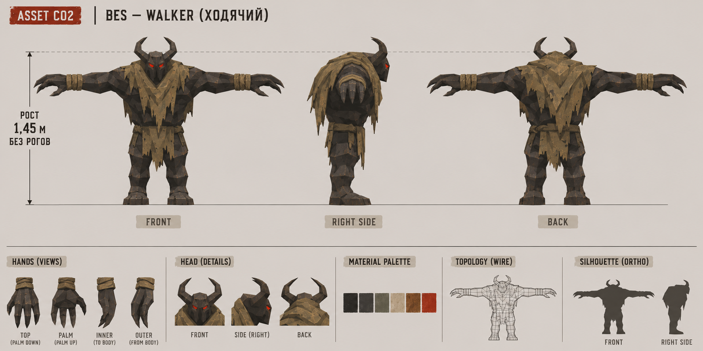

## C03 — Бес — стоящий

**Приоритет:** P0. **Статус:** развитие утверждённого визуала.  
**Размер:** рост 1,70 м без рогов.  
**Pivot:** между стопами на уровне пола.  
**Имя файла:** `C03_demon_sentry.glb`.

Квадратный торс и тяжёлые руки. Ноги должны быть отдельными под нижними пластинами, несмотря на неподвижность в бою.

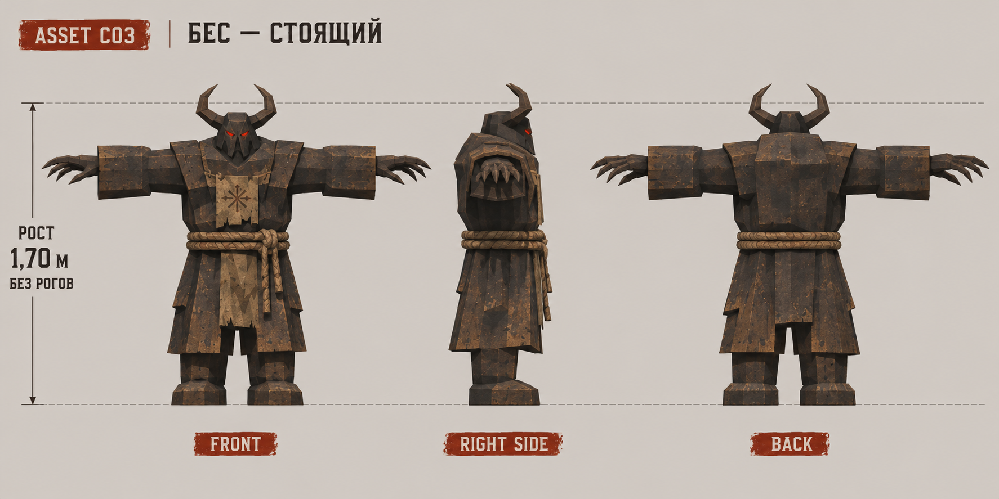

## C04 — Бес — быстрый

**Приоритет:** P0. **Статус:** развитие утверждённого визуала.  
**Размер:** рост 1,15 м в нейтральной стойке без рогов.  
**Pivot:** между стопами на уровне пола.  
**Имя файла:** `C04_demon_fast.glb`.

Тонкий угловатый силуэт. Не фиксировать беговой присед в геометрии: для рига нужна нейтральная стойка.

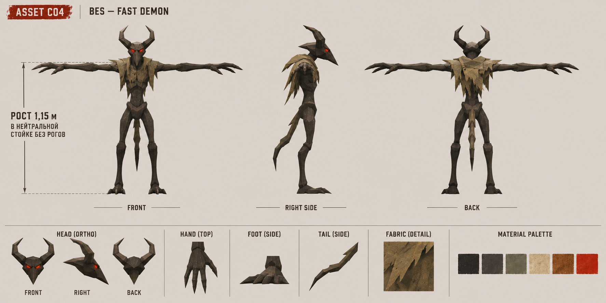

## C05 — Босс — бес Ленин

**Приоритет:** P2. **Статус:** новый предложенный дизайн; поздний этап.  
**Размер:** рост 4,00 м без рогов.  
**Pivot:** между стопами на уровне пола.  
**Имя файла:** `C05_boss_lenin.glb`.

Поздний этап. Новый предложенный визуал, а не утверждённая модель босса. Оружие не требуется; основные атаки — телом и жестами.

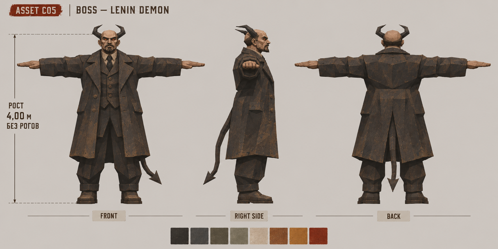

## C06 — Дьявол — персонаж сюжетных сцен

**Приоритет:** P2. **Статус:** новый предложенный дизайн; поздний этап.  
**Размер:** рост 2,20 м без рогов.  
**Pivot:** между стопами на уровне пола.  
**Имя файла:** `C06_devil.glb`.

Поздний этап. Новый предложенный визуал. Хвост виден в профиле и сзади; крылья и трон не нужны.

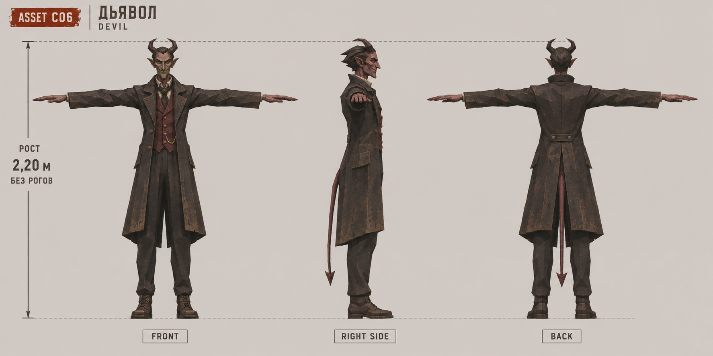

## W01 — Серп

**Приоритет:** P0. **Статус:** развитие утверждённого визуала.  
**Размер:** общая длина 0,55 м; рукоять 0,28 м.  
**Pivot:** в центре хвата рукояти.  
**Имя файла:** `W01_sickle.glb`.

Центр хвата — точка крепления. Серп предназначен для левой кисти. Сталь и рукоять читаются раздельно. Приложен отдельный размерный чертёж PNG и его векторный исходник W01_sickle.svg; рабочая толщина металла около 6 мм, диаметр хвата около 30 мм.

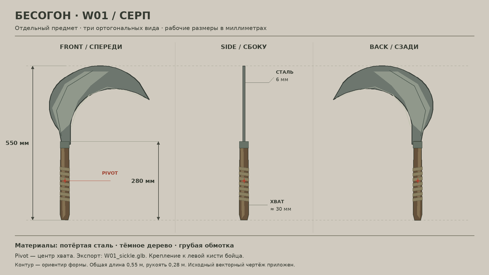

## W02 — Молот

**Приоритет:** P0. **Статус:** развитие утверждённого визуала.  
**Размер:** длина 0,60 м; головка 0,24 × 0,14 × 0,14 м.  
**Pivot:** в центре хвата рукояти.  
**Имя файла:** `W02_hammer.glb`.

Центр хвата — точка крепления. Молот предназначен для правой кисти. Размеры головки в ведомости важнее перспективного вставочного вида.

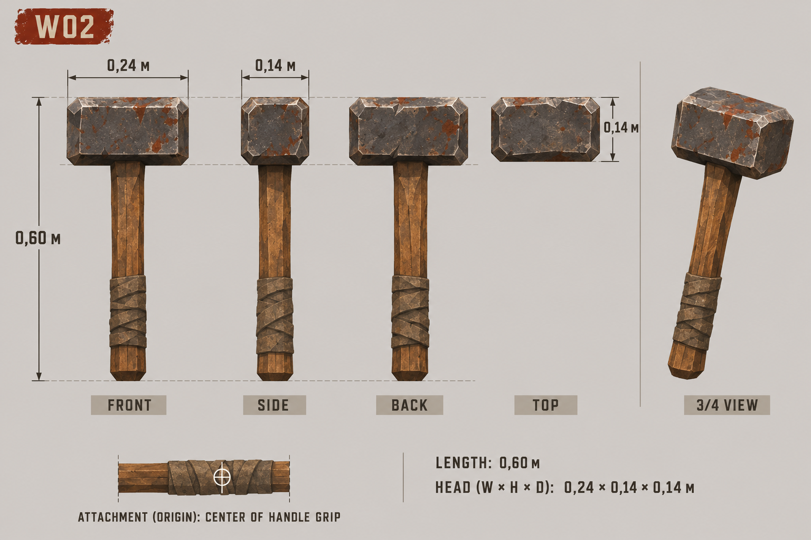

## W03 — Красный платок — отдельный аксессуар

**Приоритет:** P1. **Статус:** развитие утверждённого визуала.  
**Размер:** хвост 0,90 × 0,18 м; петля под шею бойца.  
**Pivot:** центр крепления у шеи.  
**Имя файла:** `W03_red_scarf.glb`.

Длинный хвост около 0,90 м; положение на C01 — ориентир посадки. Если на рисунке видны дополнительные свободные концы, оставить один основной длинный и один короткий. Не дублировать аксессуар поверх встроенной копии.

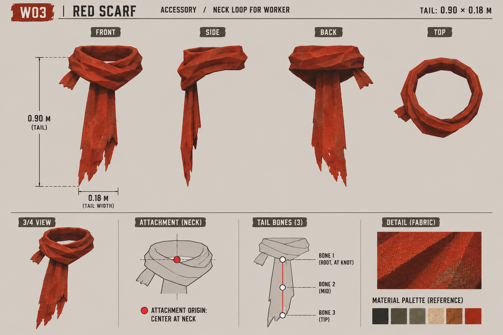

## E01 — Пол — брусчатка

**Приоритет:** P0. **Статус:** развитие утверждённого визуала.  
**Размер:** 2,00 × 2,00 × 0,12 м.  
**Pivot:** центр верхней поверхности, Y=0.  
**Имя файла:** `E01_cobblestone_floor.glb`.

Верхняя опорная плоскость Y=0, толщина уходит вниз. Строго квадратные края без камней, выступающих за границу. Лужи не моделировать.

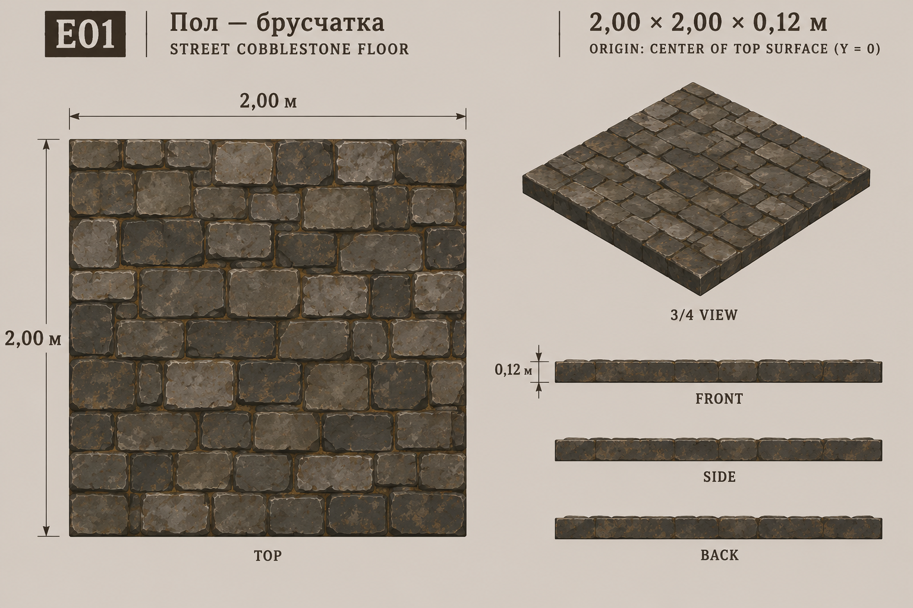

## E02 — Стена — прямой модуль

**Приоритет:** P0. **Статус:** развитие утверждённого визуала.  
**Размер:** 4,00 × 3,00 × 0,30 м (ширина × высота × толщина).  
**Pivot:** центр основания.  
**Имя файла:** `E02_brick_wall_straight.glb`.

Оба торца ровные; высота и толщина одинаковы с E03. Ширину держать 4 м.

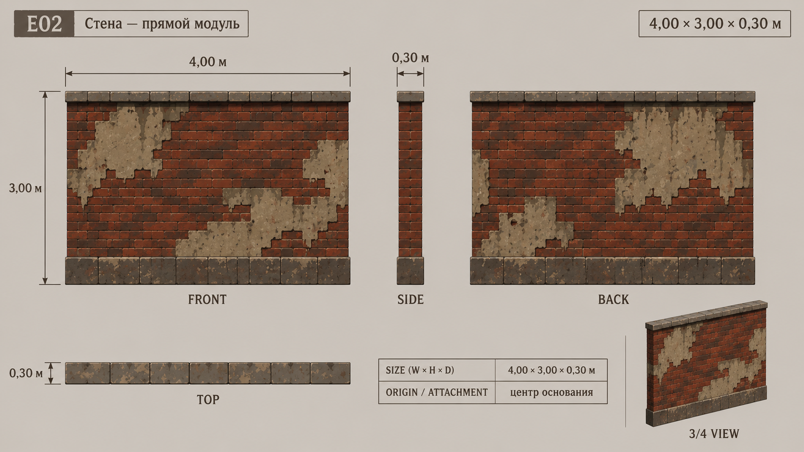

## E03 — Стена — угловой модуль

**Приоритет:** P0. **Статус:** развитие утверждённого визуала.  
**Размер:** наружный габарит 2,00 × 2,00 м; высота 3,00 м; толщина 0,30 м.  
**Pivot:** наружная нижняя вершина угла.  
**Имя файла:** `E03_brick_wall_corner.glb`.

L-образный угол. Наружный план 2×2 м, толщина 0,30 м. Торцы и основание стыкуются с E02. Геометрию L брать по плану TOP и виду 3/4. Узкий вид с подписью SIDE на рисунке показывает торец толщиной 0,30 м; это не полный боковой силуэт L-модуля.

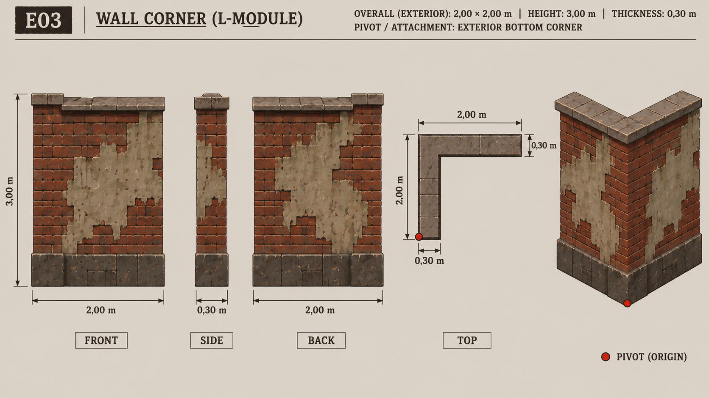

## E04 — Кирпичный столб

**Приоритет:** P0. **Статус:** развитие утверждённого визуала.  
**Размер:** 0,60 × 0,60 × 3,20 м; шапка до 0,80 × 0,80 м.  
**Pivot:** центр основания.  
**Имя файла:** `E04_masonry_pier.glb`.

Кирпичный столб отдельно от ограды и ворот. Максимальная ширина шапки 0,80 м.

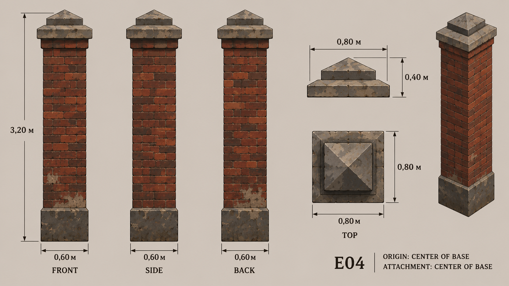

## E05 — Арка — рама портала

**Приоритет:** P0. **Статус:** развитие утверждённого визуала.  
**Размер:** 4,00 × 4,50 × 0,60 м; проход 2,40 × 3,20 м.  
**Pivot:** центр прохода на уровне пола.  
**Имя файла:** `E05_portal_arch.glb`.

Физическая арка с пустым проходом. Портальное свечение, частицы и поверхность сделаю в Godot. Стену за проходом не создавать.

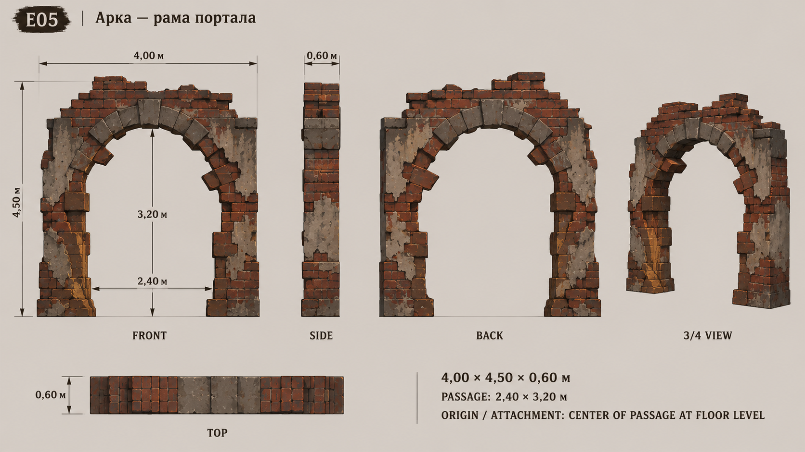

## E06 — Заводские ворота — две створки

**Приоритет:** P0. **Статус:** развитие утверждённого визуала.  
**Размер:** проём 4,00 × 3,00 м; две створки по 2,00 м.  
**Pivot:** петли каждой створки у земли.  
**Имя файла:** `E06_factory_gate.glb`.

Два отдельных полотна и нейтральное закрытое положение. Кирпичные столбы — отдельный E04. Проверить оси петель.

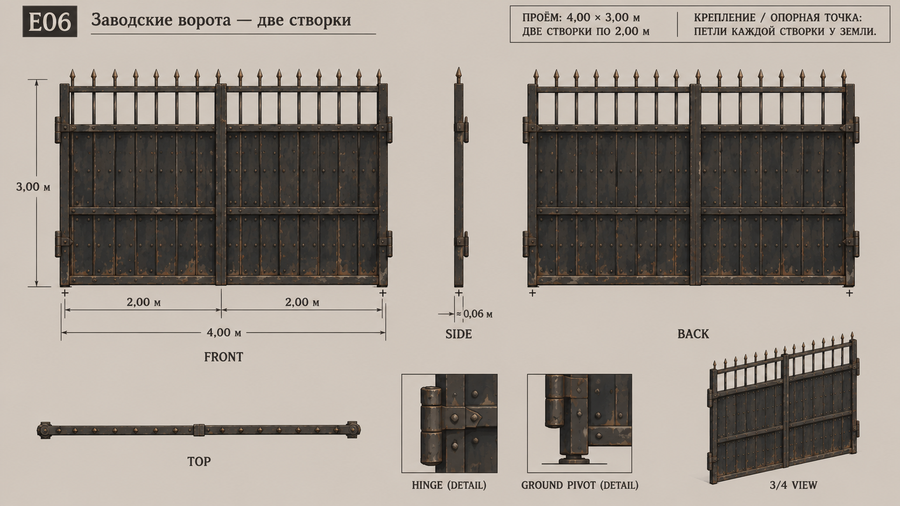

## E07 — Железная ограда

**Приоритет:** P1. **Статус:** развитие утверждённого визуала.  
**Размер:** 2,00 × 1,60 × 0,08 м.  
**Pivot:** центр основания.  
**Имя файла:** `E07_iron_fence.glb`.

Один повторяемый пролёт без кирпичных столбов. Отверстия между прутьями реальные.

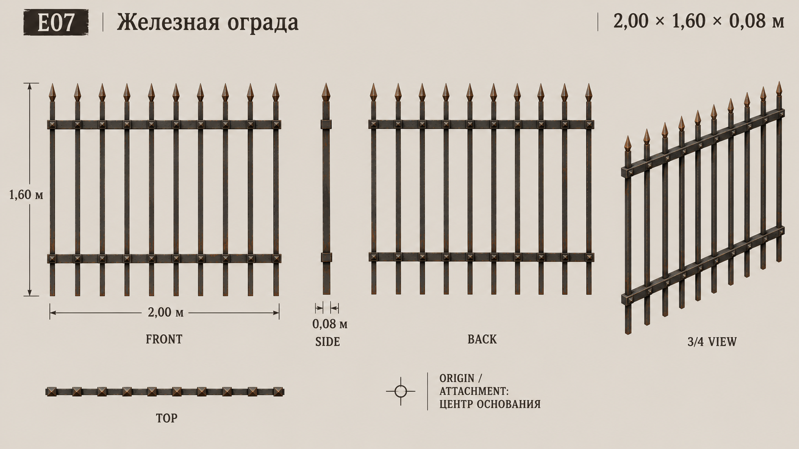

## E08 — Фасад — модуль с окном

**Приоритет:** P1. **Статус:** развитие утверждённого визуала.  
**Размер:** 4,00 × 4,00 × 0,35 м; оконный проём 1,00 × 1,50 м.  
**Pivot:** центр основания.  
**Имя файла:** `E08_building_facade.glb`.

Один модуль с одним оконным проёмом. Нижняя грань проёма на высоте 1,50 м; сам проём 1,00×1,50 м под E09. Полноценный дом отдельно не нужен.

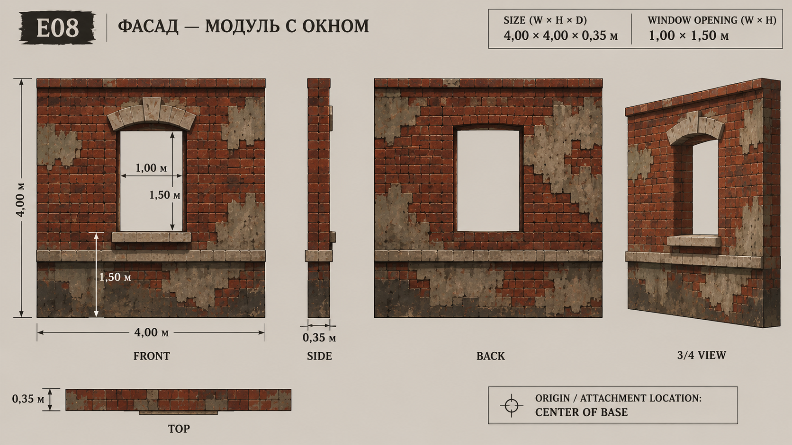

## E09 — Окно — вставка в фасад

**Приоритет:** P1. **Статус:** развитие утверждённого визуала.  
**Размер:** 1,00 × 1,50 × 0,16 м.  
**Pivot:** центр нижней грани.  
**Имя файла:** `E09_window_insert.glb`.

Рама и четыре стеклянные секции. Свет и содержимое за окном не запекать в модель.

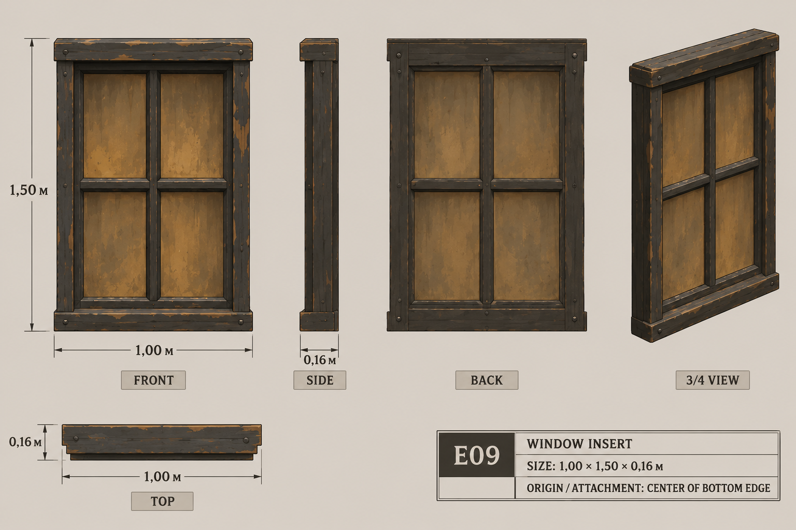

## E10 — Деревянная дверь с коробкой

**Приоритет:** P1. **Статус:** развитие утверждённого визуала.  
**Размер:** полотно 1,20 × 2,20 м; коробка 1,40 × 2,40 × 0,18 м.  
**Pivot:** нижняя точка оси петель полотна.  
**Имя файла:** `E10_wooden_door.glb`.

Отдельно полотно и коробка. В первой сборке декоративная дверь; игровой переход реализуется аркой.

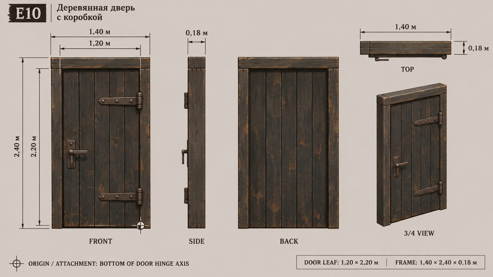

## E11 — Крыша — двускатный модуль

**Приоритет:** P1. **Статус:** развитие утверждённого визуала.  
**Размер:** 4,00 × 4,00 м по плану; высота конька 1,20 м.  
**Pivot:** центр основания по плану.  
**Имя файла:** `E11_pitched_roof.glb`.

Прямоугольный план 4×4 м; конёк выше карниза на 1,20 м. Труба — отдельный P08.

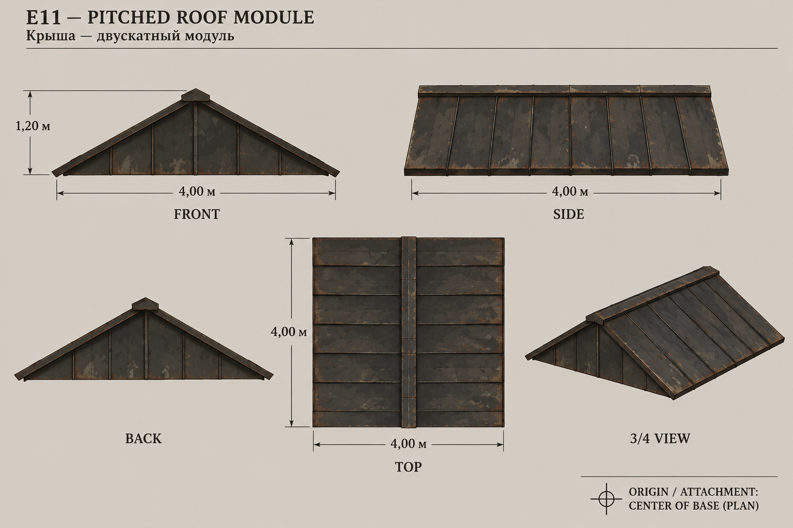

## E12 — Каменный бордюр

**Приоритет:** P1. **Статус:** развитие утверждённого визуала.  
**Размер:** 2,00 × 0,25 × 0,18 м.  
**Pivot:** центр основания.  
**Имя файла:** `E12_curb.glb`.

Прямой повторяемый сегмент; четыре крупных камня, ровные торцы.

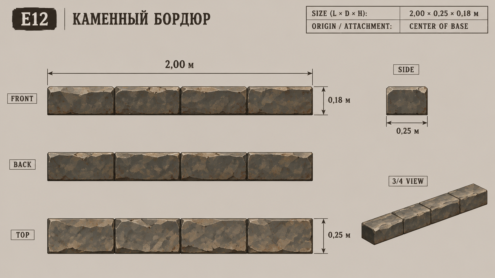

## P01 — Деревянный столб

**Приоритет:** P1. **Статус:** развитие утверждённого визуала.  
**Размер:** высота 5,00 м; ствол около 0,25 × 0,25 м.  
**Pivot:** центр основания.  
**Имя файла:** `P01_utility_pole.glb`.

Модель включает дерево, перекладины и изоляторы. Провода и фонарь отдельно.

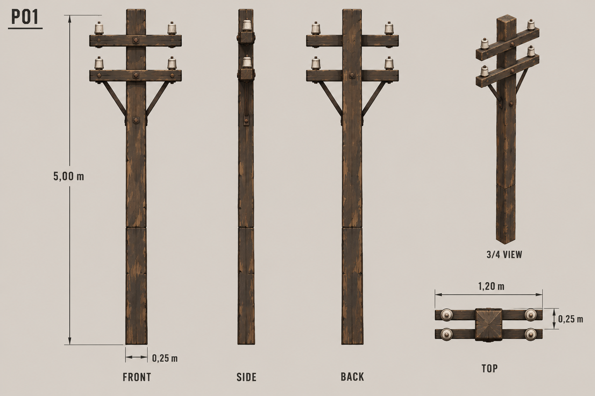

## P02 — Деревянный ящик

**Приоритет:** P1. **Статус:** развитие утверждённого визуала.  
**Размер:** 1,00 × 1,00 × 1,00 м.  
**Pivot:** центр основания.  
**Имя файла:** `P02_wooden_crate.glb`.

Один закрытый ящик. Стопки и варианты поворота соберу из повторов.

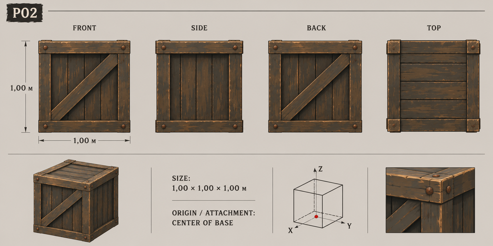

## P03 — Деревянная бочка

**Приоритет:** P1. **Статус:** развитие утверждённого визуала.  
**Размер:** диаметр 0,65 м; высота 0,95 м.  
**Pivot:** центр основания.  
**Имя файла:** `P03_wooden_barrel.glb`.

Одна закрытая бочка с читаемыми гранями. Больше одного варианта не требуется.

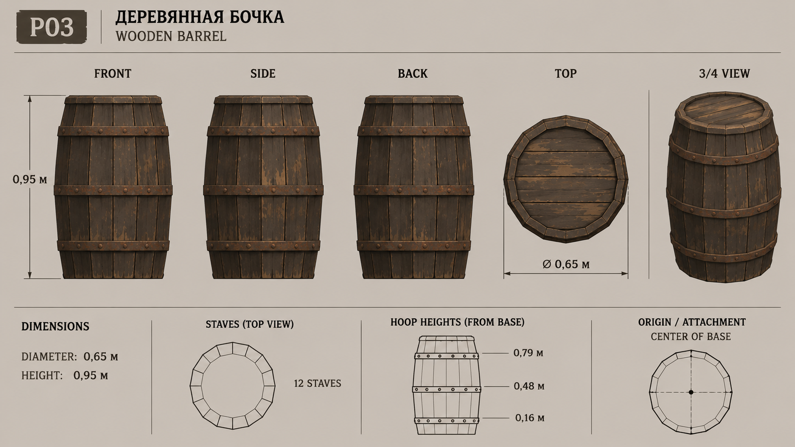

## P04 — Настенный фонарь

**Приоритет:** P1. **Статус:** развитие утверждённого визуала.  
**Размер:** корпус 0,28 × 0,28 × 0,50 м; кронштейн до 0,40 м.  
**Pivot:** точка крепления кронштейна к стене.  
**Имя файла:** `P04_wall_lantern.glb`.

Корпус со стеклом и кронштейн. Точка крепления к стене — origin. Свет и пламя отдельно.

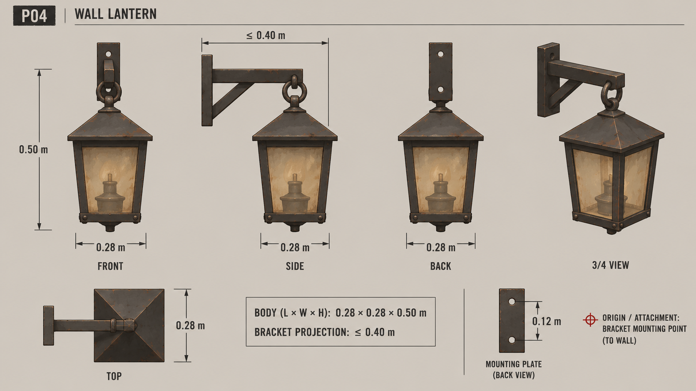

## P05 — Жаровня

**Приоритет:** P1. **Статус:** развитие утверждённого визуала.  
**Размер:** диаметр 0,65 м; высота 0,80 м.  
**Pivot:** центр основания.  
**Имя файла:** `P05_brazier.glb`.

Открытая корзина жаровни, дно и ножки. Без геометрии пламени или дыма.

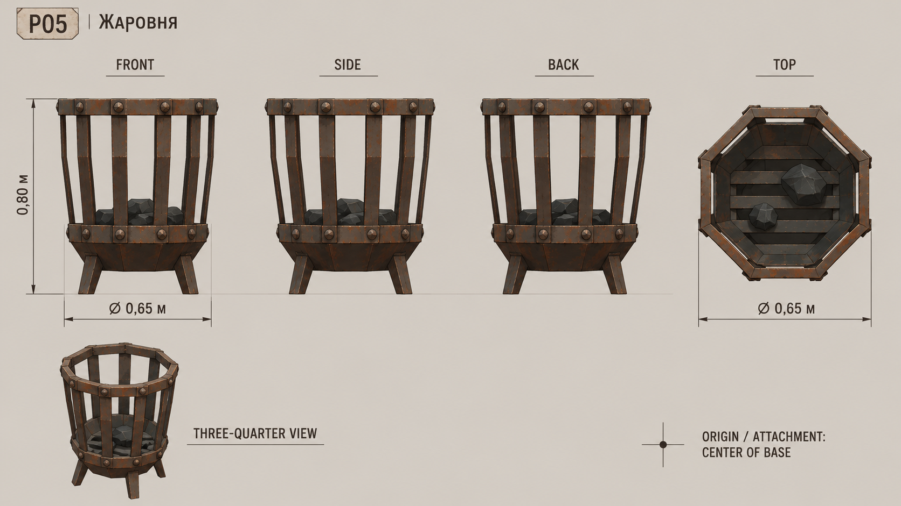

## P06 — Водосточная труба

**Приоритет:** P1. **Статус:** развитие утверждённого визуала.  
**Размер:** высота 3,00 м; диаметр 0,12 м; нижний вынос 0,25 м.  
**Pivot:** центр основания вертикальной части.  
**Имя файла:** `P06_drainpipe.glb`.

Вертикальный сегмент с нижним отводом и креплениями. Без стены и воды.

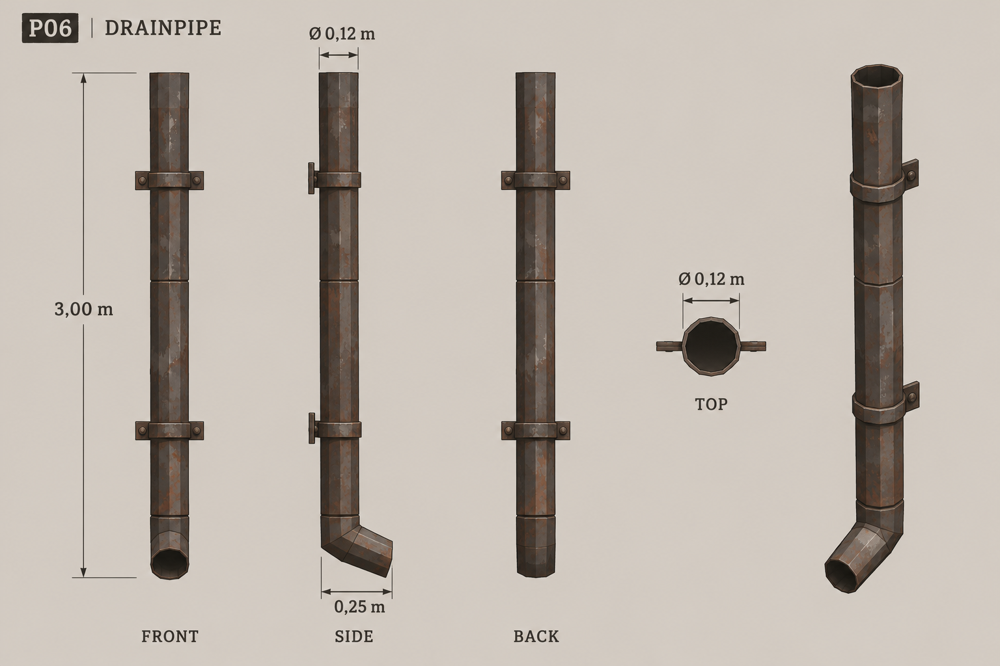

## P07 — Кучка кирпичного обломка

**Приоритет:** P1. **Статус:** развитие утверждённого визуала.  
**Размер:** 1,20 × 0,80 × 0,35 м.  
**Pivot:** центр основания.  
**Имя файла:** `P07_rubble_cluster.glb`.

Небольшая фиксированная кучка из крупных обломков. Можно оставить одним объединённым мешем.

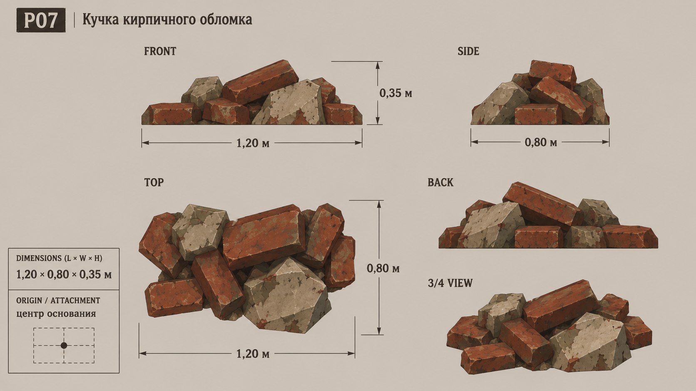

## P08 — Печная труба

**Приоритет:** P1. **Статус:** развитие утверждённого визуала.  
**Размер:** 0,80 × 0,80 × 1,50 м.  
**Pivot:** центр основания.  
**Имя файла:** `P08_brick_chimney.glb`.

Открытая сверху печная труба. Крыша и дым отдельно.

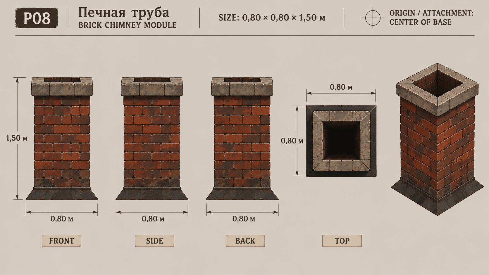

## H01 — Ад — каменный пол

**Приоритет:** P2. **Статус:** новый предложенный дизайн; поздний этап.  
**Размер:** 2,00 × 2,00 × 0,12 м.  
**Pivot:** центр верхней поверхности, Y=0.  
**Имя файла:** `H01_hell_floor.glb`.

Поздний этап. Ровная модульная верхняя плоскость, узкие трещины. Без лавы и свечения в текстуре.

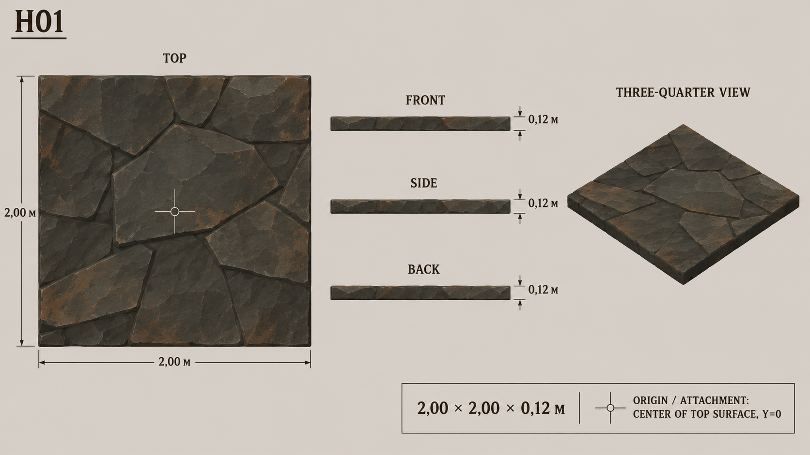

## H02 — Ад — скальная стена

**Приоритет:** P2. **Статус:** новый предложенный дизайн; поздний этап.  
**Размер:** 4,00 × 3,00 × 1,00 м.  
**Pivot:** центр основания.  
**Имя файла:** `H02_hell_rock_wall.glb`.

Поздний этап. Плоское основание и пригодные для повторения боковые зоны. Большие грани скалы, без мелкого скульптурного шума.

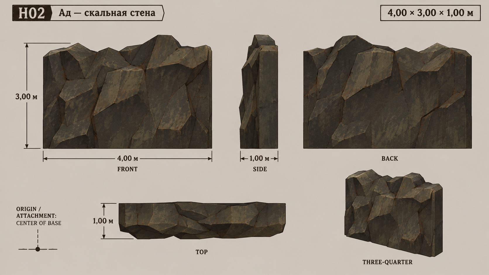
